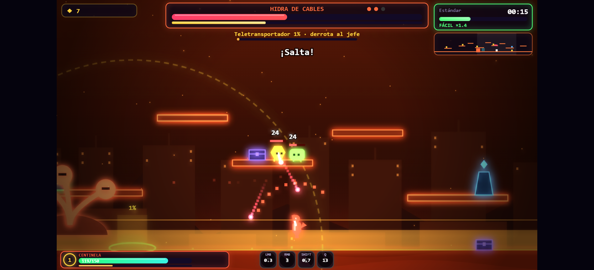
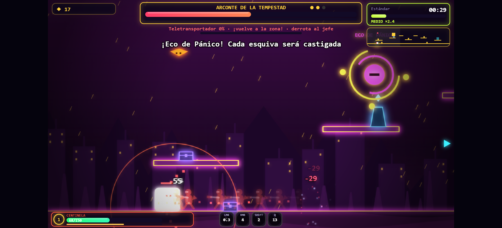

# Neón Tempestad

Roguelike de acción 2D inspirado en *Risk of Rain*, hecho en HTML5 Canvas y JavaScript puro, sin motores ni dependencias en el juego. Todos los gráficos y sonidos se generan por código: no hay sprites ni archivos de audio.

Elige uno de 20 personajes y cruza 5 escenarios. En cada uno buscas el teletransportador, aguantas su carga y derrotas al jefe. Mientras tanto acumulas objetos que se combinan entre sí, y el reloj va subiendo la dificultad.


## Contenido

- **20 personajes en 5 familias.** Cada uno tiene disparo primario, habilidad secundaria, movimiento y definitiva propios. 16 se desbloquean con logros.

  | Familia | Personajes |
  |---|---|
  | Vanguardia | Centinela, Bastión, Duelista, Titán |
  | Artillería | Cañonero, Demoledora, Ojo de Halcón, Voltaica |
  | Invocadores | Tejedor, Exhumador, Mecánica, Colmena |
  | Tiempo/Espacio | Cronista, Paradoja, Gravitón, Umbral |
  | Malditos/Híbridos | Hemomante, Berserker, Poseído, Quimera (riesgo/recompensa: gastan vida para potenciarse) |

- **Objetos.** Hay 90 acumulables: 35 comunes, 25 poco comunes, 18 raros, 9 legendarios y 3 míticos. Diez de ellos son **originales que cambian las reglas**: Corazón de la Tormenta, Espejo de Causalidad, Contrato del Vacío, Reloj Roto, Núcleo Parasitario, Memoria Artificial, Prisma Inestable, Corona del Último Rey, Fragmento de Destino y Parásito de Dimensión. Además hay 12 objetos fragmentados, que dan bonificaciones absurdas a cambio de una penalización permanente y se consiguen en altares.
- **Economía.** Oro y cofres de varias rarezas. El precio sube con la dificultad, y en Cataclismo los cofres cuestan un 30% más.
- **Escenarios y jefes.**

  | Escenario | Jefe |
  |---|---|
  | Ruinas de Neón | Coloso Prisma |
  | Fundición Carmesí | Hidra de Cables |
  | Necrópolis Espectral | Reina Espectral |
  | Abismo Digital | Leviatán de Datos |
  | Núcleo de la Tempestad | Arconte de la Tempestad |

  Cada jefe tiene 3 fases (ningún golpe puede saltarse una), barra de ruptura de guardia, ataques telegrafiados que castigan el pánico y plataformas que cambian durante el combate.
- **Modo Infinito.** Tras cada jefe, el teletransportador abre un portal dual:
  - **izquierda — Terminar run:** guarda la puntuación en la clasificación;
  - **derecha — Siguiente etapa**, o tras la etapa 5 **Continuar ciclo (Loop +1)**.

  Cada loop vuelve a la etapa 1 con otra atmósfera (Eclipse, Ceniza Tóxica, Aurora Sangrienta, Vacío Blanco…). En cada uno:
  - la dificultad se multiplica ×1,45;
  - la densidad de enemigos, ×1,5;
  - cada jefe llega acompañado de otro;
  - los topes de armadura, esquiva y enfriamientos suben hasta el 95%, para que los objetos acumulados terminen rompiendo el juego.
- **Combate.**
  - **Parry** (F · LB en mando · botón ⛨ en táctil): ventana de 0,2 s que anula el golpe, devuelve el proyectil y cura una herida. Cada familia responde distinto: Vanguardia contraataca, Artillería devuelve todos los proyectiles cercanos, Invocadores reciben dos drones, Tiempo/Espacio ralentiza alrededor y Malditos absorben vida y daño.
  - **Ejecuciones** (Interactuar junto a un enemigo debilitado, marcado con un rombo rojo): lo rematan dando vida, oro y energía.
  - **Combos**: golpes encadenados suben el daño (hasta +30%); en el aire cuentan doble y dejan a los enemigos suspendidos.
  - **Sobrecarga**: habilidades, parries, ejecuciones y combos cargan energía; al 100% hay 6 s de habilidades potenciadas y después agotamiento.
  - **Ataques contextuales**: más daño en el aire, desde arriba, justo después de un movimiento y contra enemigos aturdidos.
  - **Heridas**: algunos enemigos y jefes dejan fractura, infección, interferencia o desgarro durante 5 s.
- **Enemigos que cambian.**
  - **Armaduras**: Brutos, Gólems y Acorazados llevan placas que absorben el 60% del daño; rotas, el enemigo es más rápido y frágil y el Acorazado pierde su escudo.
  - **Evolución**: un enemigo que sobrevive 20 s (y otra vez a los 40 s) evoluciona con más vida, daño, velocidad y un rasgo (regenera, coraza, veloz o feroz). Vale más.
  - **Devoradores**: Gólems, Gelatinas y Chamanes absorben a los caídos cercanos: se curan, crecen y evolucionan antes.
  - **Cazador del Vacío**: desde la etapa 2 puede aparecer un cazador único que huye herido y vuelve en otra etapa más fuerte; a la tercera pelea hasta el final y deja un objeto legendario.
- **Neutrales e IA adaptativa.**
  - **Mercader errante**: vende dos objetos a la vista (poco común o raro) por oro.
  - **Ermitaño**: propone una misión (cacería, verdugo, reflejos, intocable o virtuoso) que recompensa con un objeto raro y oro.
  - **Eco Imitador**: enemigo que copia la última habilidad que usaste (disparo, embestida, salto tras de ti o explosión).
  - **Jefes que recuerdan**: observan tu distancia, tiempo en el aire, esquivas y habilidad favorita, y en cada fase suman una respuesta telegrafiada a ese estilo.
- **Jefes con huella.**
  - **Consecuencias**: cada jefe derrotado deja una huella para el resto de la partida (más cofres, menos torretas, espectros débiles, cofres más baratos pero menos estabilidad, más oro). Se ven en el inventario.
  - **Jefe secreto**: a veces aparece un Sello Antiguo. Con 3 ejecuciones en la etapa y la estabilidad ≥ 50% se abre y libera al **Heraldo del Vacío**, que deja dos objetos legendarios.
  - **Jefes fusionados**: en el Modo Infinito, la última etapa enfrenta a un solo jefe con los ataques del Arconte y de un jefe volador.
- **Exploración.**
  - **Sectores de gravedad**: columnas antigravedad o pozos pesados que afectan a todo lo que pasa por ellas.
  - **Salas secretas**: muros agrietados que se rompen a golpes y esconden un Cofre Dorado.
  - **Terminales**: investigan a un enemigo; su ficha queda en el **Códice** (pantalla de inicio) y da +10% de daño contra él para siempre.
  - **Mecanismos antiguos**: una trampa barre a los enemigos cercanos y se abre un compartimento con un objeto.
  - **Rescates**: libera a un explorador quedándote cerca 8 s mientras llegan enemigos; te acompaña como dron aliado.
  - **Mazmorras**: una grieta dimensional te encierra con 3 oleadas reforzadas a cambio de un objeto legendario.
- **Progresión.**
  - **Evolución de habilidades**: cada 4 niveles eliges una mejora real para una habilidad concreta (daño, enfriamiento, área, proyectiles, duración o velocidad).
  - **Mutaciones**: cada 7 niveles una mutación con ventaja y coste que dura toda la run (Piel de Vidrio, Sangre Volátil, Coraza Quitinosa…).
  - **Reliquias**: en la selección de personaje eliges una reliquia que cambia una regla de la partida. Se desbloquean **explorando**: salas secretas, terminales, rescates, mazmorras, el Cazador y el Heraldo.
- **Lobby nuevo.** Se entra directo al héroe en escena (sin portada): un taller bajo la tormenta con relámpagos que iluminan al personaje, un letrero de neón roto como luz principal, charco con reflejo, lluvia y grano. Pestañas Héroes · Arsenal · Tienda · Códice, ficha corta (las descripciones aparecen al tocar cada habilidad), tira de retratos, modo, reliquia, dificultad y ENTRAR como única acción en ámbar. Respeta «reducir movimiento».
- **Preparación y modos.**
  - **Maestría individual**: 3 ramas por héroe (su elemento, una técnica de su familia y resistencia), con puntos que se ganan jugando.
  - **Habilidades alternativas**: completar la historia personal de un héroe desbloquea una versión alternativa de su secundaria.
  - **Armas modificables**: cargador ampliado, núcleo sobrecargado, cañón largo o mecanismo rápido para el ataque principal.
  - **Compañero y sinergias**: otro héroe te acompaña, dispara y actúa con tu definitiva; 5 parejas de familias combinan sus poderes.
  - **Reputación**: Guardianes del Equilibrio, Culto de la Tormenta y Gremio Mercante recuerdan tus decisiones.
  - **Finales alternativos**: 6 finales según tus decisiones, secretos y jefes derrotados.
  - **Campaña**: modo narrativo de 5 capítulos que lleva al origen de la Tempestad.
  - **Inversión**: eres la Criatura y sobrevives a 10 oleadas de héroes.
  - **Rutas**: al cruzar el teletransportador eliges ruta segura o peligrosa; tras descubrir un secreto aparece el bioma oculto Jardín del Vacío.
  - **Transporte**: plataformas enlazadas en extremos opuestos del mapa.
- **Mundo vivo.**
  - **Fracturas temporales**: la etapa salta 40 s a otra época (Ruinas Antiguas, Ciudad del Mañana, Dimensión Colapsada) con otros colores y reglas.
  - **Clima**: lluvia, nevada, viento o cenizas, que cambian el daño elemental, el movimiento, la curación o el oro.
  - **El mapa aprende**: la zona que más usas en cada etapa queda vigilada por patrullas y la que ignoras cría un nido con cofre.
  - **Objetos que se comunican**: 7 parejas de artefactos que, al juntarse, hablan y desbloquean un efecto secreto o entran en conflicto.
- **Memoria del mundo.**
  - **Ecos**: al morir dejas un eco en esa etapa; en otra partida puede devolverte un objeto, oro o un desafío.
  - **Recuerdos**: cada jefe derrotado por primera vez revela un fragmento de la historia (en el Códice).
  - **Eventos secretos**: Quietud, Intocable y Cartógrafo, con condiciones ocultas.
  - **Desafíos personales**: cada héroe tiene una historia de 3 capítulos que da cristales.
- **La Tempestad viva.**
  - **Personalidad**: cada 50 s lee tu estilo y reacciona con premio: desafío de élites si eres agresivo, cerco de rayos si esquivas, secretos si exploras.
  - **Deuda dimensional**: el Acreedor presta objetos raros y legendarios; cobra en oro al empezar cada etapa y, si no pagas, los enemigos pegan más y llegan cobradores.
  - **Corrupción**: barra para todos los héroes (fragmentos, energía absorbida, préstamos, núcleos) que da daño a cambio de curación y enemigos más duros; al 100% aparece tu **Sombra Corrupta**.
  - **Núcleo de cada escenario**: destruirlo, estabilizarlo o absorberlo cambia esta etapa y la siguiente.
  - **Tormentas personales**: cada familia tiene su anomalía (Tormenta de Hierro, Lluvia de Ojivas, Marea de Espíritus, Anomalía Temporal, Tormenta Sangrienta) que también altera sus habilidades.
- **Elementos.** Cinco elementos de daño (fuego, rayo, vacío, plasma, corrupción) y el estado de hielo. Cada héroe golpea con el suyo; cada enemigo y jefe tiene una debilidad (×1,5) y una resistencia (×0,6), y el plasma nunca es resistido. Las **reacciones** premian combinar: rayo sobre un enemigo helado (Resonancia, salta a los vecinos), fuego sobre helado (Choque Térmico), fuego sobre envenenado (Combustión) y vacío sobre electrizado (Colapso, atrae y aturde).
- **Enemigos.** 15 tipos (voladores, tiradores, kamikazes, tanques, etc.) y 11 afijos de élite.
- **Dificultades.**

  | Dificultad | Efecto |
  |---|---|
  | Paseo Estelar | Reloj un 30% más lento y 1 resurrección |
  | Estándar | Sin modificadores |
  | Tormenta de Riesgo | Reloj +25%, élites +40%, curación −20% |
  | Cataclismo | Reloj +60%, cofres +30%, élites con doble afijo |
  | Pesadilla Absoluta | Empieza en el minuto 45 con nivel 20 y 24 objetos. Los proyectiles dejan zonas de daño en el suelo. Muerte permanente: al morir se borra la partida |

- **Aspecto y sonido.**
  - Imagen: bloom, viñeta, aberración cromática, hit-stop, temblor de pantalla configurable, animación procedural, parallax de 4 capas y soporte HiDPI.
  - Calidad gráfica alta, media o baja.
  - Música y efectos sintetizados con Web Audio. La música cambia al cargar el teletransportador y al pelear contra el jefe.
- **Cuentas y clasificación online (Firebase).**
  - Una cuenta, con usuario y contraseña, sirve en cualquier dispositivo.
  - Ranking global con una pestaña por dificultad: posición, usuario, personaje, nivel, loop, tiempo y puntuación. Compite con tus amigos.
  - Sin conexión se juega igual: las partidas quedan en cola y se suben al volver la red.
  - Mientras haya pocas partidas reales, la tabla se completa con jugadores ficticios, atenuados y marcados «IA», que no cuentan para tu puesto.
  - Las reglas del servidor solo permiten publicar con tu propio nombre y con valores razonables. Nadie puede editar ni borrar puntuaciones.
- **Personajes articulados.** Cada héroe tiene esqueleto (cabeza, torso, piernas y brazos animados), una capa con física y un arma que apunta al cursor. Además lleva equipo propio: los aros del Cronista, los planos holográficos de la Mecánica, la cola de la Quimera, etc.
- **La Tempestad.** Cada etapa tiene una **estabilidad dimensional** (100 → 0) que erosionan el tiempo, las bajas de élites, las definitivas y las fases de jefe.
  - Al cruzar 75, 25 y 0 se desata una **anomalía**: gravedad baja, tormenta eléctrica, lluvia de meteoritos, proyectiles acelerados, enemigos tormentosos o niebla dimensional. Algunas etapas ya empiezan en plena tormenta.
  - Dos anomalías concretas se **combinan** en un efecto nuevo (gravedad baja + tormenta eléctrica = orbes eléctricos flotantes).
  - Al cruzar 50, la Tempestad ofrece un **trato**: estabilizar (menos enemigos, objeto poco común), alimentar (otra anomalía y más enemigos, objeto raro y +50% de oro) o absorber (60 s de poder con consecuencia).
- **Tienda de cosméticos.**
  - Con los cristales 💎 que ganas al terminar cada partida (según la puntuación) compras cosméticos puramente visuales: 9 skins, 7 estelas y 6 auras.
  - La vista previa los muestra en movimiento antes de comprarlos.
- **Pantalla de inicio.** Logo animado, desfile de héroes con tus cosméticos equipados y accesos a jugar, tienda, ranking y opciones.
- **Guardado.** Logros, desbloqueos, récords por dificultad, ajustes y la partida en curso, que se puede continuar desde el inicio de la etapa.






## Controles

Todas las teclas se pueden reasignar en **🎮 Controles**, desde el menú o desde la pausa.

| Acción | Teclado y ratón | Mando (Xbox / PlayStation) |
|---|---|---|
| Moverse | A / D o ← / → | Stick izquierdo o cruceta |
| Saltar (doble salto) | Espacio, W o ↑ | A / ✕ |
| Bajar de plataforma | S o ↓ | Stick abajo |
| Disparo primario | Clic izquierdo (apunta con el ratón) | RT o stick derecho (apunta) |
| Habilidad secundaria | Clic derecho | LT |
| Movimiento | Shift | B / ○ o RB |
| Definitiva | Q | Y / △ o LB |
| Interactuar (cofres, altares, teletransportador) | E | X / □ |
| Inventario | Tab o I | Select |
| Pausa | Esc o P | Start |
| Silenciar | M | — |

**En móvil:**
- Los controles táctiles aparecen solos: un joystick donde apoyes el dedo y botones para cada acción.
- El apuntado puede ser automático (al enemigo más cercano) o con un segundo joystick. Se elige en **⚙ Opciones**.
- El juego se juega en horizontal.


## Jugar

**En el navegador:** abre `html/index.html`. No necesita servidor ni instalación.

Hay dos parámetros de URL para pruebas:
- `html/index.html?unlockall`: desbloquea todos los personajes y salta la pantalla de cuenta.
- `html/index.html?guest`: entra directamente como invitado.
- `html/index.html?debug`: la tecla B activa el teletransportador.

## Desarrollo

Hace falta Node.js 18 o superior.

```bash
npm install          # Electron, electron-builder y Capacitor (solo para empaquetar)
npm test             # pruebas automáticas sin navegador: personajes × dificultades × etapas
npm run test:browser # prueba en Chrome/Edge/Brave real: capturas, FPS y errores de consola
```

### Escritorio (Windows, instalador)

```bash
npm start      # abre el juego en una ventana de Electron (F11 pantalla completa)
npm run dist   # genera dist/NeonTempestad-Setup-<versión>.exe (y borra los de versiones anteriores)
```

El instalador no pide permisos de administrador. Instala el juego en `%LOCALAPPDATA%\Programs
eon-tempestad`, con acceso directo en el escritorio y en el menú Inicio. Cada versión nueva **se instala encima de la anterior**, y las partidas y la configuración (guardadas en el perfil del usuario) se conservan.

`npm run dist` construye en una carpeta temporal y solo copia el `.exe` a `dist/`. Así evita el bloqueo con el que VS Code deja abiertos los `.asar` dentro del proyecto.

> Si `npm start` abre una consola de Node en vez del juego, la variable de entorno `ELECTRON_RUN_AS_NODE` está activa (la terminal integrada de VS Code la define). Lánzalo desde otra terminal o con `env -u ELECTRON_RUN_AS_NODE npm start`.

### Android (APK con Capacitor)

```bash
npm run apk    # genera dist/NeonTempestad-<versión>.apk firmado, listo para instalar
```

**Requisitos:** JDK 21 y SDK de Android. Hay dos formas de tenerlos:
- Instalar [Android Studio](https://developer.android.com/studio) y definir `JAVA_HOME` y `ANDROID_HOME`.
- Usar las versiones portátiles de `%LOCALAPPDATA%
eon-android`, que es lo que hace el script si no encuentra esas variables.

**Firma:** la primera vez se crea una clave en `~/.neon-tempestad/` (`release.jks` y `keystore.json`).
> ⚠️ **Haz una copia de seguridad de esa carpeta y no la subas al repositorio.** Android solo instala una actualización encima de la anterior si está firmada con la misma clave. Si la pierdes, cada jugador tendrá que desinstalar el juego (y perder su progreso) para instalar la siguiente versión.

Para abrir el proyecto en Android Studio: `npm run android && npm run android:open`.

**Notas:**
- `tools/android-setup.js` bloquea la orientación horizontal en `AndroidManifest.xml` con `sensorLandscape`, y copia el icono y la pantalla de carga.
- Además, el juego pide pantalla completa en horizontal al tocar la pantalla.
- Cada vez que cambies el código del juego, vuelve a ejecutar `npm run android`.

### Publicar una actualización (obligatoria)

**Cómo funciona:**
- **Escritorio:** el botón «Actualizar ahora» descarga el instalador nuevo de la release y comprueba su huella SHA-256, publicada en `version.json`. Después lo instala encima en silencio y vuelve a abrir el juego. Si algo falla, abre la página de descargas.
- **Android:** descarga el APK nuevo directamente. Al abrirlo se instala encima, porque está firmado con la misma clave.
- Al abrirse, y cada 30 minutos, el juego lee [`version.json`](version.json) de la rama `main` de GitHub.
- Si la versión instalada es menor que `min`, aparece una pantalla de **actualización obligatoria**. No se puede cerrar y lleva a la página de descarga.
- Si llega en mitad de una partida, espera a que termine.
- Sin conexión se puede seguir jugando.

**Sacar una versión nueva (un solo comando):**
```bash
npm run release -- 1.3.0 "Qué trae esta versión"
```
El comando hace todo esto en orden:
1. Comprueba que estás en `desarrollo`, sin cambios pendientes, y que las pruebas pasan.
2. Sube la versión y genera el instalador `.exe` y el APK. Antes borra de `dist/` los de versiones anteriores, y publica la huella del instalador en `version.json`.
3. Hace commit y push, y crea la release `v1.3.0` en GitHub con los dos archivos.
4. Por último lleva `desarrollo` a `main`. Desde ese momento, todas las copias anteriores quedan bloqueadas hasta actualizar.

Necesita la herramienta [`gh`](https://cli.github.com) con la sesión iniciada (`gh auth login`), además de los requisitos del `.exe` y del APK. El orden importa: `version.json` llega a `main` solo cuando la descarga ya existe.

### Icono y pantalla de carga

El icono del `.exe` (`build/icon.png`), los iconos de Android y su pantalla de carga (`build/android/res/`) también se dibujan por código. Para regenerarlos después de cambiar el diseño en `tools/make-icons.js`, ejecuta `node tools/make-icons.js`. Hace falta Chrome, Edge o Brave.

### Servidor (Firebase)

El proyecto de Firebase es `neon-tempestad`. Usa **Authentication** (correo y contraseña; el juego convierte el usuario en `usuario@neontempestad.game`) y **Firestore**, con la clasificación en `boards/{0-4}/scores`. Se puede entrar con usuario (el juego lo convierte en `usuario@neontempestad.game`) o con un correo real; las cuentas con correo eligen un nombre de usuario, que se reserva en `names/{nombre}` y `owners/{uid}` (uno por cuenta, sin chocar con los usuarios clásicos). Las reglas de seguridad están en [`firestore.rules`](firestore.rules): se pegan en la consola de Firebase › Firestore › Reglas › Publicar.

**Una entrada por jugador.** Cada jugador aparece una sola vez en el ranking de cada dificultad, con su mejor marca: la puntuación se guarda en `boards/{d}/scores/{uid}` y solo se reemplaza por una mayor. Las entradas antiguas repetidas se juntan al mostrar la tabla.

**Familia Joke** (`js/joke.js`). Seis héroes de broma con arte propio: Gerpillo (cepillo de dientes), Morchopsito (dinosaurio con ovni de sombrero), Juanchito (vóley: saque, salto y remate que elimina de un golpe), Bachata Man (bailarín helado), Frutillini (frutilla con palo de hockey; remata sus bochas con parry, crítico asegurado) y Cafesito (café alienígena). En el lobby, una etiqueta con la familia abarca del primer al último retrato de cada grupo.

**Derechos de autor.** © 2026 thaigo naboni, todos los derechos reservados (ver `LICENSE`).

**Mundo ampliado** (`js/expand.js`). Cada etapa mide 4000 px: el diseño original queda en el centro (a veces espejado) y a los lados hay tramos de plataformas que se generan distinto en cada partida, con una cuerda (mantén saltar para trepar) y una tirolesa (interactuar en el anclaje). Una trampilla lleva al **subsuelo**: dos oleadas y un guardián, y al vencerlo, dos objetos y oro; se vuelve por la escotilla. Cada 70–100 s puede aparecer un **evento**: una baliza que hay que defender 20 s o un cofre maldito con guardianes. Durante el jefe, el **escenario ataca** (lluvia de cristales, chorros de escoria, manos de la cripta, escombros o relámpagos, según la etapa).

**Desafío diario.** En el lobby, el modo Diaria da a todos el mismo héroe, dificultad, regla del día (doble oro, cristal u horda dura) y mapas, con su propio ranking (`boards/dAAAAMMDD`, pestaña «Diaria (hoy)»).

**Tutorial.** La primera vez que entras con cada personaje se juega una etapa guiada, sin puntuación ni ranking: moverse, saltar, sus cuatro habilidades, qué hace daño y qué no, oro y cofres, el teletransportador, el jefe y el portal. Se puede saltar, y al terminar empieza la partida de verdad (`js/tutorial.js`; lo ya visto queda en `Save.d.tut`).

**Menú de pruebas.** Las cuentas listadas en `DEV_UIDS` (`js/dev.js`) ven un botón DEV en partida (o pulsan F2): hitboxes, invulnerable, sin enfriamientos, matar de un golpe, velocidad del juego, dar objetos, invocar enemigos y jefes, saltar etapa y cambiar de personaje. Una partida en la que se usó el menú no sube al ranking. El juego habla con la API REST directamente, sin librerías, y la `apiKey` va en `js/auth.js`: no es secreta, lo que protege los datos son las reglas.

Para borrar una puntuación (trampas, pruebas…) entra en la consola de Firebase › Firestore › `boards` › dificultad › `scores` y elimina el documento.

### Estructura

| Archivo | Contenido |
|---|---|
| `html/index.html` | Página del juego (carga `../css` y `../js`) |
| `css/style.css` | Estilos de menús y pantallas |
| `js/engine.js` | Estado, física, combate, bucle principal |
| `js/renderer.js` | Dibujo procedural: héroes articulados, enemigos, luz aditiva, sacudida direccional |
| `js/fx.js` | Pools de partículas y proyectiles, post-procesado, números de daño |
| `js/data_characters.js`, `js/data_items.js`, `js/data_enemies.js`, `js/data_stages.js` | Contenido declarativo |
| `js/abilities.js`, `js/loot.js`, `js/enemies.js`, `js/bosses.js`, `js/stages.js` | Lógica de habilidades, objetos, enemigos, jefes y escenarios |
| `js/audio.js`, `js/save.js`, `js/input.js`, `js/touch.js`, `js/ui.js` | Sonido, guardado, controles, táctil, interfaz |
| `js/auth.js` | Cuentas y clasificación online (Firebase), puntuación |
| `js/update.js`, `version.json` | Comprobación de versión y actualización obligatoria |
| `js/main.js`, `js/preload.js`, `js/updater.js` | Ventana de escritorio (Electron) y actualización automática verificada |
| `js/cosmetics.js` | Tienda: skins, estelas y auras |
| `js/elements.js` | Elementos: debilidades, resistencias y reacciones |
| `js/combat.js` | Parry, ejecuciones, combos, sobrecarga, contexto y heridas |
| `js/ecology.js` | Armaduras, evolución, devoradores y el Cazador del Vacío |
| `js/adaptive.js`, `js/npcs.js` | IA adaptativa (imitador, jefes que recuerdan) y neutrales (mercader, ermitaño y misiones) |
| `js/bossplus.js` | Consecuencias de jefes, jefe secreto (Heraldo del Vacío) y jefes fusionados |
| `js/explore.js` | Gravedad por zonas, salas secretas, terminales y Códice, mecanismos, rescates y mazmorras |
| `js/progression.js` | Evolución de habilidades, mutaciones, reliquias y desbloqueos por descubrimiento |
| `js/lobby.js` | Escena del lobby (capas, luz, lluvia, cambio de héroe) y controles de pestañas, modo, dificultad y ENTRAR |
| `js/routes.js` | Rutas alternativas, bioma oculto y plataformas de transporte |
| `js/loadout.js` | Maestría individual, armas, compañero y sinergias, reputación, finales, campaña e inversión |
| `js/world.js` | Fracturas temporales, clima, mapa que aprende y objetos que se comunican |
| `js/lore.js` | Ecos de partidas anteriores, recuerdos de jefes, eventos secretos y desafíos personales |
| `js/tempest.js` | Personalidad de la Tempestad, deuda, corrupción, Sombra Corrupta y núcleos |
| `js/storm.js` | La Tempestad: estabilidad, anomalías, combinaciones y tratos |
| `tools/` | Pruebas (`smoke.js`, `browser.js`) y scripts de empaquetado |

Las sinergias entre objetos van por un bus de eventos: `onHit`, `onKill`, `onJump`, `onTakeDamage`, `onLevelUp`, `onCast`, `onDash`, `onHeal`, `onChestOpen` y `onBossPhase`.

## Hoja de ruta

**Hecho**
- [x] Fase 1: los 20 personajes y la selección con desbloqueos por logros.
- [x] Fase 2: los 80 objetos, los fragmentados con sus altares, la economía y el inventario.
- [x] Fase 3: los 5 escenarios y sus jefes, 15 enemigos, 11 afijos, el teletransportador y las 5 dificultades.
- [x] Fase 4: mejora visual y *game feel*.
- [x] Fase 5: audio, guardado, controles configurables, mando y controles táctiles.
- [x] Fase 6: escritorio con Electron, Android con Capacitor y este README.
- [x] Carpetas por extensión, cuentas con clasificación, héroes articulados y Modo Infinito.

**Pendiente**
- [ ] Probar en móviles y mandos reales: ajustar el tamaño de los botones táctiles y la sensibilidad.
- [ ] Más escenarios.
