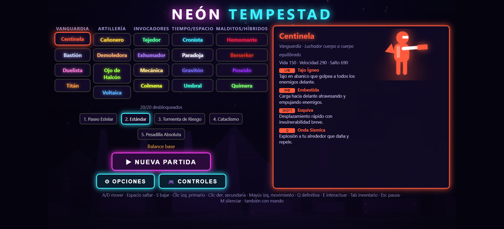
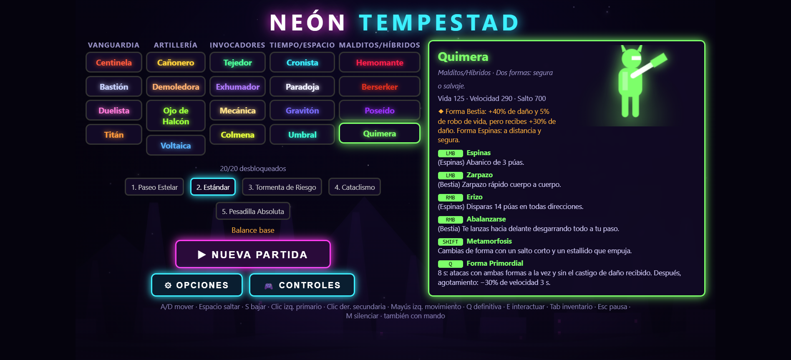
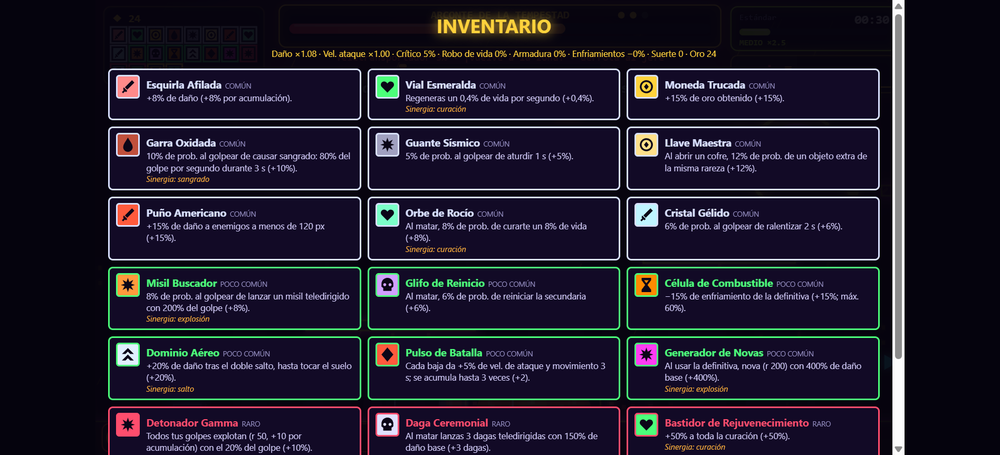
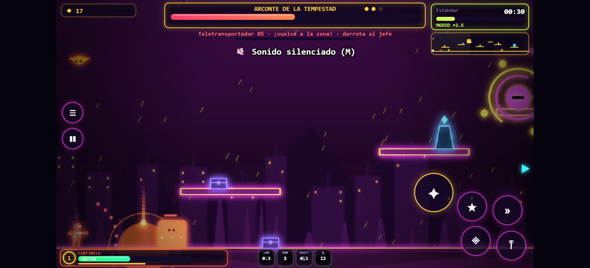

# Neón Tempestad

Roguelike de acción 2D inspirado en *Risk of Rain*, hecho en HTML5 Canvas y JavaScript puro, sin motores ni dependencias en el juego. Todos los gráficos y sonidos se generan por código: no hay sprites ni archivos de audio.

Elige uno de 20 personajes y cruza 5 escenarios. En cada uno buscas el teletransportador, aguantas su carga y derrotas al jefe. Mientras tanto acumulas objetos que se combinan entre sí, y el reloj va subiendo la dificultad.



## Contenido

- **20 personajes en 5 familias.** Cada uno tiene disparo primario, habilidad secundaria, movimiento y definitiva propios. 16 se desbloquean con logros.

  | Familia | Personajes |
  |---|---|
  | Vanguardia | Centinela, Bastión, Duelista, Titán |
  | Artillería | Cañonero, Demoledora, Ojo de Halcón, Voltaica |
  | Invocadores | Tejedor, Exhumador, Mecánica, Colmena |
  | Tiempo/Espacio | Cronista, Paradoja, Gravitón, Umbral |
  | Malditos/Híbridos | Hemomante, Berserker, Poseído, Quimera (riesgo/recompensa: gastan vida para potenciarse) |

- **Objetos.** Hay 80 acumulables: 35 comunes, 25 poco comunes, 12 raros, 5 legendarios que cambian las reglas y 3 míticos. Además hay 12 objetos fragmentados, que dan bonificaciones absurdas a cambio de una penalización permanente y se consiguen en altares.
- **Economía.** Oro y cofres de varias rarezas. El precio sube con la dificultad, y en Cataclismo los cofres cuestan un 30% más.
- **Escenarios y jefes.**

  | Escenario | Jefe |
  |---|---|
  | Ruinas de Neón | Coloso Prisma |
  | Fundición Carmesí | Hidra de Cables |
  | Necrópolis Espectral | Reina Espectral |
  | Abismo Digital | Leviatán de Datos |
  | Núcleo de la Tempestad | Arconte de la Tempestad |

  Cada jefe tiene 3 fases (ningún golpe puede saltarse una), barra de ruptura de guardia, ataques telegrafiados que castigan el pánico y plataformas que cambian durante el combate.
- **Enemigos.** 15 tipos (voladores, tiradores, kamikazes, tanques, etc.) y 11 afijos de élite.
- **Dificultades.**

  | Dificultad | Efecto |
  |---|---|
  | Paseo Estelar | Reloj un 30% más lento y 1 resurrección |
  | Estándar | Sin modificadores |
  | Tormenta de Riesgo | Reloj +25%, élites +40%, curación −20% |
  | Cataclismo | Reloj +60%, cofres +30%, élites con doble afijo |
  | Pesadilla Absoluta | Empieza en el minuto 45 con nivel 20 y 24 objetos. Los proyectiles dejan zonas de daño en el suelo. Muerte permanente: al morir se borra la partida |

- **Aspecto y sonido.**
  - Imagen: bloom, viñeta, aberración cromática, hit-stop, temblor de pantalla configurable, animación procedural, parallax de 4 capas y soporte HiDPI.
  - Calidad gráfica alta, media o baja.
  - Música y efectos sintetizados con Web Audio. La música cambia al cargar el teletransportador y al pelear contra el jefe.
- **Guardado.** Logros, desbloqueos, récords por dificultad, ajustes y la partida en curso, que se puede continuar desde el inicio de la etapa.






## Controles

Todas las teclas se pueden reasignar en **🎮 Controles**, desde el menú o desde la pausa.

| Acción | Teclado y ratón | Mando (Xbox / PlayStation) |
|---|---|---|
| Moverse | A / D o ← / → | Stick izquierdo o cruceta |
| Saltar (doble salto) | Espacio, W o ↑ | A / ✕ |
| Bajar de plataforma | S o ↓ | Stick abajo |
| Disparo primario | Clic izquierdo (apunta con el ratón) | RT o stick derecho (apunta) |
| Habilidad secundaria | Clic derecho | LT |
| Movimiento | Shift | B / ○ o RB |
| Definitiva | Q | Y / △ o LB |
| Interactuar (cofres, altares, teletransportador) | E | X / □ |
| Inventario | Tab o I | Select |
| Pausa | Esc o P | Start |
| Silenciar | M | — |

**En móvil:**
- Los controles táctiles aparecen solos: un joystick donde apoyes el dedo y botones para cada acción.
- El apuntado puede ser automático (al enemigo más cercano) o con un segundo joystick. Se elige en **⚙ Opciones**.
- El juego se juega en horizontal.



## Jugar

**En el navegador:** abre `index.html`. No necesita servidor ni instalación.

Hay dos parámetros de URL para pruebas:
- `index.html?unlockall`: desbloquea todos los personajes.
- `index.html?debug`: la tecla B activa el teletransportador.

## Desarrollo

Hace falta Node.js 18 o superior.

```bash
npm install          # Electron, electron-builder y Capacitor (solo para empaquetar)
npm test             # pruebas automáticas sin navegador: personajes × dificultades × etapas
npm run test:browser # prueba en Chrome/Edge/Brave real: capturas, FPS y errores de consola
```

### Escritorio (Windows, `.exe` portable)

```bash
npm start      # abre el juego en una ventana de Electron (F11 pantalla completa)
npm run dist   # genera dist/NeonTempestad-1.0.0-portable.exe
```

El `.exe` portable no necesita instalación y guarda las partidas en el perfil del usuario.

> **Si `npm run dist` falla con `EBUSY` sobre un `.asar`:**
> - **Causa:** VS Code (o una de sus extensiones) tiene abiertos los archivos de la carpeta `dist/` de una construcción anterior.
> - **Solución:** cierra VS Code y borra `dist/`, o construye fuera del proyecto con `npx electron-builder --win portable -c.directories.output=../neon-dist`.
>
> Si `npm start` abre una consola de Node en vez del juego, la variable de entorno `ELECTRON_RUN_AS_NODE` está activa (la terminal integrada de VS Code la define). Lánzalo desde otra terminal o con `env -u ELECTRON_RUN_AS_NODE npm start`.

### Android (APK con Capacitor)

**Requisitos:** [Android Studio](https://developer.android.com/studio), que incluye el SDK de Android y el JDK.

```bash
npm run www               # copia el juego a www/
npx cap add android       # solo la primera vez: crea el proyecto android/
npm run android           # actualiza www/, sincroniza y bloquea la orientación horizontal
npm run android:open      # abre el proyecto en Android Studio
```

**Generar el APK en Android Studio:**
- Para probar: *Build › Build Bundle(s) / APK(s) › Build APK(s)*. El APK de depuración queda en `android/app/build/outputs/apk/debug/`.
- Para publicar: *Build › Generate Signed Bundle / APK*.

También se puede generar desde la terminal con `cd android && gradlew assembleDebug`.

**Notas:**
- La orientación horizontal se bloquea en `AndroidManifest.xml` con `sensorLandscape`, mediante `tools/android-landscape.js`.
- Además, el juego pide pantalla completa en horizontal al tocar la pantalla.
- Cada vez que cambies el código del juego, vuelve a ejecutar `npm run android`.

### Estructura

| Archivo | Contenido |
|---|---|
| `engine.js` | Estado, física, combate, bucle principal |
| `fx.js`, `art.js` | Pools de partículas y proyectiles, post-procesado, dibujo procedural |
| `data_characters.js`, `data_items.js`, `data_enemies.js`, `data_stages.js` | Contenido declarativo |
| `abilities.js`, `loot.js`, `enemies.js`, `bosses.js`, `stages.js` | Lógica de habilidades, objetos, enemigos, jefes y escenarios |
| `audio.js`, `save.js`, `input.js`, `touch.js`, `ui.js` | Sonido, guardado, controles, táctil, interfaz |
| `main.js` | Ventana de escritorio (Electron) |
| `tools/` | Pruebas (`smoke.js`, `browser.js`) y scripts de empaquetado |

Las sinergias entre objetos van por un bus de eventos: `onHit`, `onKill`, `onJump`, `onTakeDamage`, `onLevelUp`, `onCast`, `onDash`, `onHeal`, `onChestOpen` y `onBossPhase`.

## Hoja de ruta

**Hecho**
- [x] Fase 1: los 20 personajes y la selección con desbloqueos por logros.
- [x] Fase 2: los 80 objetos, los fragmentados con sus altares, la economía y el inventario.
- [x] Fase 3: los 5 escenarios y sus jefes, 15 enemigos, 11 afijos, el teletransportador y las 5 dificultades.
- [x] Fase 4: mejora visual y *game feel*.
- [x] Fase 5: audio, guardado, controles configurables, mando y controles táctiles.
- [x] Fase 6: escritorio con Electron, Android con Capacitor y este README.

**Pendiente**
- [ ] Probar en móviles y mandos reales: ajustar el tamaño de los botones táctiles y la sensibilidad.
- [ ] Icono propio para el `.exe` y el APK.
- [ ] Más escenarios y un modo infinito tras el Arconte.
